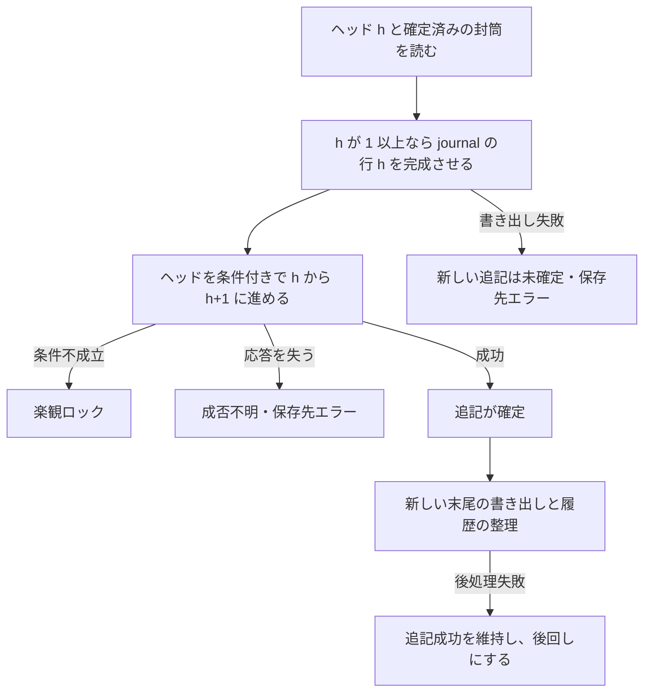

# Bigtable storage profile (finalized)

Places the commit point of the [common contract](../core-contract.md) in the conditional update of a single head row. The event that is about to be replaced in the head is first written out to the journal. Reads are done by combining the journal with the tail event of the head that was fetched.

> Created on 2026-10-04. It presupposes P-28, P-29, P-30 to P-35, and ADR-0005 and 0006. The main decisions BT-D1 to D5, BT-D6a, BT-D6b, and BT-D7 in chapter 1 were agreed on the same day ([ADR-0007 for the history placement](../../adr/0007-store-bigtable-snapshot-history-with-events.md), [ADR-0008 for the storage format of the envelope](../../adr/0008-fix-bigtable-envelope-binary-format.md)), and the concrete realization of the BT rules that had been drafts was finalized on 2026-10-16 (P-55). The first version does not provide a change feed (BT-D8, P-56). BT-15 stays a draft and is finalized when a change feed is provided. This is not a ratification of the current implementation, which advances only the head. Implementers first check the commit, reads, and recovery in chapters 1 to 6. Terminology follows [CONTEXT.md](../../../CONTEXT.md).

## 1. Keep the head small, and place history in the journal rows

| Decision | Adopted proposal | Main alternatives | Status |
|:--|:--|:--|:--|
| BT-D1 | Prepare in advance, by an external initialization procedure, the two tables journal and head and a configuration item with the same store_id. The library checks, and rejects missing or mismatched items | Automatically initialize both tables at construction | Agreed (2026-10-04) |
| BT-D2 | Place the snapshot history of that append in the event's row as well. Leave a deleted marker for history | Place the newest n in fixed slots of the head, or copy history to a separate table | Agreed (2026-10-04), ADR-0007 |
| BT-D3 | Fix all operations in operation to the same cluster, and allow single-row transactions. During a failure, return a storage error and wait for recovery | Also design a cluster switch that includes stopping writers, confirming replication, and resuming | Agreed (2026-10-04) |
| BT-D4 | The initial layout provides only immediate deletion of history. Leave the events and the deleted markers, and maintain the append success even if retention processing fails | Also add an expiry style, moving marked history to a separate column family and removing it by GC | Agreed (2026-10-04) |
| BT-D5 | Optionally provide a change feed via Change Streams on the head. Save the subscription position, remove duplicates, and resynchronize after expiry | The first version does not provide a change feed | Agreed (2026-10-04). Kept as the decision for when it is provided (BT-D8) |
| BT-D6a | Make the storage format of the envelope the fixed binary format in chapter 4. Fix integers, field order, and lengths across all languages, and manage changes to the format by a version number | JSON, Protocol Buffers | Agreed (2026-10-04), ADR-0008 |
| BT-D6b | Set the upper limit of one envelope including metadata per store. The default is 1MiB and the maximum is 8MiB. Record it in both tables, and reject mismatches between clients | A fixed 1MiB, a fixed 8MiB | Agreed (2026-10-04) |
| BT-D7 | Before advancing the head, confirm the write-out of the immediately preceding committed event and the necessary history. If it cannot be confirmed, a new append is a storage error | Design a method that holds multiple not-yet-written-out items in the head | Agreed (2026-10-04) |
| BT-D8 | The first version does not provide a change feed. A setting that requests it is a configuration error | Provide it from the first version as in BT-D5 | Agreed (2026-10-16) |

BT-D6 was split into BT-D6a and BT-D6b in order to confirm the storage format and the size limit independently.

BT-D8 was added following the owner's decision on 2026-10-15 not to include the change feed in the version being re-released (the change feed is ultimately needed, but its priority is low). It takes the same form as SQ-D8 and SQ-20 of the SQLite profile, and a setting that requests a feed is a configuration error. Another reason is that the Bigtable emulator does not support change subscription (ReadChangeStream) and it cannot be tested locally. BT-D5 and BT-14 are kept as the decision and rule for when it is provided.

By the agreement of BT-D7, while the write-out of the immediately preceding committed data cannot be confirmed, the next append is not committed. That writer does not advance the head, and returns a storage error. Reads do not require the write-out, and combine the journal with the tail of the fetched head. A failure of the write-out after the commit or of retention processing does not change the result of an append that already succeeded.

The fixed slot proposal requires the product of the retention count n and the envelope size to fit in the row size. The separate table proposal requires additional recovery and indexing procedures for failures and delays of copying history. By the agreement of BT-D2, the approach of using an atomic write-out to the journal row and event cells that are not deleted to prevent history from being recreated is adopted. In retention processing, there is a cost of examining the aggregate's journal range.

## 2. Make the same cluster the path for reads and writes

- **MUST BT-1**: Reads, writes, retention, and configuration checks in operation use an app profile fixed to the same cluster. Single-row transactions are allowed. Even in a configuration with a replica cluster, the adapter's operations are aligned to this cluster. During a failure of the cluster in use, return a storage error and wait for recovery. Simultaneous writes to multiple clusters, multi-cluster routing, and automatic failover are out of scope, and the procedure for a planned switch is designed separately (SP-1, agreed 2026-10-04, BT-D3). [Conditional writes](https://cloud.google.com/bigtable/docs/writes) atomically check and update one row on this path.
- **MUST BT-2**: Create in advance the column families `event` and `history` of journal, `head` and `snapshot` of head, and `config` of both tables. Do not set age-based GC on data column families. Set the version-count GC to at most 1, but also limit reads to one cell per column. Do not make correctness depend on a delay in GC ([GC specification](https://cloud.google.com/bigtable/docs/garbage-collection)) (agreed 2026-10-16, P-55).

The key of the configuration row is the single byte `0x00`. The keys of data rows are in the form of chapter 3, so they do not exactly match this configuration row. Save a UTF-8 JSON object in `config:metadata`, holding `store_id` (a lowercase UUID string), `layout_version` (the integer 1), `keep_snapshot_count`, `retention_mode` (the string `delete`), and `envelope_limit_bytes`. By the agreement of BT-D6b, the envelope limit is an integer number of bytes, with a default of 1048576 and a maximum of 8388608. The retention count is null for none, and when set it is a decimal string of a positive integer, without exponent notation or leading zeros. This is to avoid the conversion of JSON numbers to floating point. Only the retention count is made a string because the retention count is an integer of 1 or more with no upper limit decided (S-1) and can take values up to signed 64 bits, so there may be values that cannot be represented exactly in double-precision floating point. The layout version (1) and the envelope limit (at most 8388608) are limited to small values, so they can stay as JSON integers.

By the agreement of BT-D1, initialization is done by an external procedure when there are no writers. Writers are started after both tables and the settings are in place. In ordinary store construction, both settings are read with strong consistency and the types and values of the fields are compared. The order of JSON keys and whitespace are not compared. A missing required field, a duplicated JSON key, or a mismatch is a configuration error. A setting that is missing on only one side is not filled in automatically. The storage format and fields of the setting were finalized as drafted (agreed 2026-10-16, P-55).

The configuration row is written at initialization and at the setting change of the retention count in chapter 7, and is read at every construction while the store is in use. If age-based GC is attached to the `config` column family of both tables, the configuration row will eventually disappear, and by the rule above, subsequent construction becomes a configuration error because the setting is missing. Therefore, a layout that attaches no age-based GC to `config` either is recommended. This paragraph is an explanation and adds no rule (agreed 2026-10-22, P-60).

The retention count and retention style are aligned per store, and writers with different settings are not run at the same time. To change the retention count, organize the existing history by the setting change procedure in chapter 7, and then update the settings of both tables. The first version does not provide a change feed, and a setting that requests the feed is a configuration error by BT-17 (BT-D8). In a version that provides a change feed, by the agreement of BT-D5 it is provided as an optional capability. In a store that uses the feed in that version, Change Streams is set only on head, and the cluster and the retention period are checked. A store that does not use it is not required to enable it.

## 3. Use keys that include the length, so that ranges do not overlap with another aggregate

`A` is the UTF-8 of aid, and `H` is the 8-byte big-endian output of [FNV-1a 64](hash.md). `L16` is the byte length of A as an unsigned 16-bit big-endian value.

```text
P(aid)             = H(aid) || L16(length(A)) || A
head の行キー      = P(aid)
journal の行キー   = P(aid) || U64BE(seq_nr)
```

- **MUST BT-3**: The assembly, type name, and length of aid follow T-1, T-11, and T-12. Since the length is included, even if hashes collide, the P of a different aid is not a prefix match. Even if aid contains `#`, NUL, or Japanese, that byte sequence is not interpreted as a delimiter (SP-2) (agreed 2026-10-16, P-55).
- **MUST BT-4**: seq_nr is an 8-byte unsigned big-endian value. The order of row keys matches the order of seq_nr. When building ranges, do not use decimal strings, the language's Display, or `prefix + 0xff` (agreed 2026-10-16, P-55).

Only in the case of `start = max(1, seqNr) < h` in the event retrieval at head position h, build the journal range from `P || U64BE(start)` inclusive to `P || U64BE(h)` exclusive. h is not included in this range, and h's envelope is added from the fetched head. The branches for when there is no head, when start > h, and when start = h are made before building the range (chapter 6).

<a id="4-封筒と履歴の削除状態を固定する"></a>

## 4. Fix the envelope and the deleted state of history

By the agreement of BT-D6a, the library assembles the envelope as the following byte sequence. The leading `0x01` is the format version number. The serializer passed to payload handles only the payload (T-7). `U16`, `U32`, and `U64` are big-endian, and `I64` is a big-endian signed 64-bit two's complement.

```text
イベント = 0x01 || U16(aid の長さ) || aid の UTF-8 || U64(seq_nr)
          || I64(occurred_at_ns) || U32(manifest の長さ) || manifest の UTF-8
          || U32(payload の長さ) || payload
スナップショット = 0x01 || U64(seq_nr)
                  || U32(manifest の長さ) || manifest の UTF-8
                  || U32(payload の長さ) || payload
```

Lengths are in bytes. Unused trailing bytes, length mismatches, and unknown format versions are storage errors. If restoring the payload of a correct envelope fails, it is a serialization error. The event's occurred_at_ns and seq_nr are checked against the ranges of the common contract.

| Table and cell | Value |
|:--|:--|
| head / `head:seq_nr` | A 20-digit zero-padded ASCII number. Used for the head check |
| head / `head:last_event` | The event envelope of that seq_nr |
| head / `head:has_snapshot` | ASCII `1` if that append is accompanied by a snapshot, and ASCII `0` if events only |
| head / `snapshot:current` | The current snapshot envelope. If there is none, there is no cell either |
| journal / `event:envelope` | The event envelope of the seq_nr of that row key. Not deleted |
| journal / `event:has_snapshot` | ASCII `1` or `0`, the same as head. Used for verifying the write-out, and not deleted |
| journal / `history:state` | ASCII. `active` when the retention target is first written out, and `retired` after it is deleted |
| journal / `history:envelope` | The history snapshot envelope. Deleted when it is made `retired` |

If a retention count is not set, no history cells are created. For a head with `has_snapshot = 1`, the seq_nr of snapshot:current matches the head's seq_nr. In an events-only append, `has_snapshot = 0` is set while the current snapshot remains stored.

- **MUST BT-5**: The new creation of a journal row writes the event, flags, and necessary history in one CheckAndMutateRow only when `event:envelope` is absent. An existing row is not overwritten, and the event and flags are checked. If a row accompanied by history is active, the stored snapshot envelope is also checked against the fetched value, and a missing or mismatched one is a storage error. The history of a row with `history:state = retired` is not recreated. The existence of the event cell becomes the marker that prevents history from being recreated by a delayed write-out (agreed 2026-10-16, P-55).
- **MUST BT-6**: The cell timestamp of the initial creation of the journal is the fixed value 0µs. In an update of the head, delete all versions of the column to be replaced, and then write the new value in the same atomic operation. The update of the retention state takes the same form. The CAS filter is limited to the latest one cell of the target column before checking the value, and does not match cells of a past seq_nr or an active one (agreed 2026-10-16, P-55).

The cell timestamp is for Bigtable's management and is not used for occurred_at. The [Bigtable timestamp specification](https://cloud.google.com/bigtable/docs/writes) is a microsecond value with millisecond precision, so the domain's nanoseconds are stored in the envelope's I64.

- **MUST BT-16**: Set a store-wide size limit on one serialized envelope including metadata. The default is 1MiB and the maximum is 8MiB. The value is recorded in the configuration items of both tables, and checked against the value the client uses. A mismatch is a configuration error. A value in which even the smallest envelope does not fit, or one exceeding the maximum, is also a configuration error. Input exceeding the limit is rejected before writing as a contract violation that includes the rule BT-16 and the relevant seq_nr (agreed 2026-10-04, BT-D6b). Setting changes are made externally with all clients using the store stopped, and checked at reconstruction.

The head holds neither all events nor n items of history. It holds only the event envelope, the current snapshot, and fixed metadata, so the head row does not grow even if n increases. The proposed limit is a decision to keep it smaller than the [recommended sizes for rows and cells](https://cloud.google.com/bigtable/quotas), and does not have the same meaning as a mandatory limit of Bigtable itself.

## 5. Write out the preceding event, then advance the head

- **MUST BT-7**: After finishing the input checks and serialization, execute the following in order (agreed 2026-10-16, P-55).

1. Read the target row of head with strong consistency. If there is no row, h=0; if there is, verify h and the last envelope. A row missing required cells is not regarded as a new aggregate.
2. Check the input's seq_nr by W-3 and W-8. Continue only for the correct next append for h.
3. If h>0, write the fetched last event h to the journal by BT-5. If there is a retention count and the fetched head has `has_snapshot=1`, also create that snapshot h initially in the same row. If the write-out cannot be confirmed, it is a storage error, and the head is not advanced.
4. Execute the head's CheckAndMutateRow. A new creation initializes on the side where the seq_nr column does not exist. An update applies only on the side where seq_nr is the fetched h, and writes the new seq_nr, event envelope, and has_snapshot. If accompanied by a snapshot, current is replaced in the same operation. **The success of this operation is the commit point of the append** (H-1).
5. Write out the new tail event to the journal, and attempt the retention processing of history. A failure is notified and postponed. The committed append is not returned as a failure.

If the update's CAS fails, another write was committed after the fetched h, so it is an optimistic lock. The same applies when a new creation's CAS loses to an earlier creation. If the CAS result could not be received, it is a storage error of unknown outcome. The CAS failing due to the SDK's automatic resend is not used as evidence that the original operation was uncommitted.



Step 3 is a mandatory write-out to protect the committed journal from the replacement of the head (agreed 2026-10-04, BT-D7). It is distinguished from the organization of old history in step 5. When history is written to the same journal row, it is included in the atomic initial creation of that row. A procedure that writes only the history in a separate RPC and overwrites the last snapshot while that has failed is not adopted.

### Always, before h is in the journal, and h is in the head

At the first commit, the envelope for h=1 is in the head. Since the row for h is completed before advancing from h to h+1, when the committed head is h, 1 to h−1 are in the journal. This property is maintained even for events-only appends.

A snapshot-accompanied append s is also written out to the journal row with seq_nr=s before the next append. The latest s=h, which has not yet been written out, is in head's current. This avoids a procedure in which the copy of history into a separate row fails and past snapshots are lost.

## 6. Fetch the head first, and add its tail to the read result

- **MUST BT-8**: The latest snapshot is obtained with one read of the head row. head and the necessary columns of current are restored from the same ReadRows row. The pair of R-2 is atomic, and snapshot.seq_nr is at most h (R-8). Even without a snapshot, return h and "no snapshot" (agreed 2026-10-16, P-55).
- **MUST BT-9**: In event retrieval, first fetch head's h and the envelope of event h, and keep using those values afterward. Let `start = max(1, seqNr)`, and before building the journal RowRange, branch as follows (agreed 2026-10-16, P-55).
  1. If there is no head (h=0), or start > h, return an empty event sequence. Do not request ReadRows on the journal.
  2. If start = h, return only the fetched envelope of h. Do not request ReadRows on the journal.
  3. If start < h, read through the journal from start to h−1 using the range of chapter 3, and add the fetched envelope of h at the end.

Even if the head advances, do not re-fetch midway through the read. Journal rows at or above h are not mixed into the range of this read. This prevents the h added from the head and the physical row h from being duplicated, and prevents returning only part of what follows (R-4 to R-6). 0 is read as 1. Even for an SDK that rejects the case where the start of a range is greater than the end, the above branches avoid building an invalid range ([RowRange specification](https://docs.cloud.google.com/python/docs/reference/bigtable/latest/common_data_read_rows_query)).

- **MUST BT-10**: Assemble the splitting of cells and rows in ReadRows, and add to the result after confirming the completion of a row. On premature termination, resume from after the last completed row, and discard the partial row and re-read it. If there are gaps in the journal's target range (from `max(1, seqNr)` to h−1), it is a storage error. Journal events are not deleted and the upper limit h is also fixed, so the target range does not change even on resumption (agreed 2026-10-16, P-55).

The reader is not obliged to make a write-out succeed in order to retrieve events. It can be read through with the journal range and the fetched tail alone.

## 7. Even after history is deleted, do not revive it with a delayed copy

When a retention count n is set, the logical placement of history is the pair of the active history in the journal and the tail snapshot of the head that has not yet been written out. The cache of the current snapshot is not deleted by retention processing.

- **MUST BT-11**: After the commit of a snapshot-accompanied append, fix the head's position h, and read the seq_nr of the active history in 1 to h of that aid's journal. The physical key range is from `P || U64BE(1)` to the exclusive bound `P || U64BE(h+1)`. h+1 is used only as a read bound and is not numbered as an event. If h is accompanied by a snapshot and the row does not exist yet, add the fetched h to the list as well. If the row exists, discard the duplicate, and do not return a retired h to active. Protect the newest n, and make only the physical rows older than that candidates (agreed 2026-10-16, P-55).
- **MUST BT-12**: For a candidate journal row, only when history:state is active, delete history:envelope and set state to retired. Do both in one CheckAndMutateRow, and leave the event cells. If it is already retired, do nothing. Because of the initial-creation condition of BT-5, a delayed writer also cannot revive history (agreed 2026-10-16, P-55).

The basis for removing a candidate q is that "there are n committed snapshots newer than q". Even if writes progress further after the read, this basis is not lost. Not mixing writers that change the retention count midway is also a premise of this property.

Since only the active state column is read, there is no need to transfer history payloads for retention processing. In an SDK where reverse ReadRows can be used, read from the newer side. If not, read through the same range in ascending order and select. Since rows with events only are also examined, the cost is affected by the length of the aggregate's journal. An optimization that provides a separate index, including the procedure for keeping copy failures and deleted markers, is treated as a separate agreement.

- **MUST BT-13**: A retention failure is notified but does not change the result of the committed append. Re-execute at the next snapshot write or in explicit maintenance (S-4). The first version provides only the deletion of history payloads, and does not provide the expiry style of S-3. Events and deleted markers are left. A setting that requests TTL is a configuration error (agreed 2026-10-04, BT-D4).

### A change to the retention count setting is reflected after organizing the existing history

This is done by an external management procedure. Unlike ordinary per-aid operations, it enumerates all heads except the configuration row and checks the history of each aggregate.

1. Stop all clients that use the store, and confirm that the appends, reads, write-outs, retention, and subscriptions in progress have ended. Save the setting before the change, the target setting, and the progress of the processing in a management record that can be used for resuming.
2. Read each head's position h and tail, and complete and confirm the write-out of BT-5 with the **retention count before the change**. If history was retained before the change and the tail is accompanied by a snapshot, include that history in the same initial creation. This is so that the tail's history, which is not yet in a physical row, is not dropped from the selection under the new count.
3. Read through the active history up to h for each aid. If the target is n, keep the newest n, and if it is none, target all active history, and delete the payload and set retired by BT-12. Do not change the events' envelopes and flags, the head, or the current snapshot. Do not erase existing retired markers, and do not recreate history.
4. After the organization of all aggregates is complete, align the settings of both tables to the target value. Reconstruct all clients to check the settings, and resume processing.

If it fails midway, keep it stopped and re-run to the same target in the management record. Write-outs and deletions that are already complete do not revive history even if repeated. Even if only one of the two settings was updated, do not resume until the check and update are finished. Deleted history cannot be restored, so a rollback of the whole store is not presupposed. When the count is increased, or when a count is set from none, past history that was deleted or was not retained is not fabricated. History is not added to existing event rows, and the new setting is applied from subsequent snapshot writes.

## 8. Emit only committed changes of the head to the feed

- **MUST BT-17**: The first version does not provide a change feed (BT-D8). The operation of constructing a store with a setting that requests the feed is a configuration error (agreed 2026-10-16, P-56).
- **MUST BT-14** (if provided): Subscribe to Change Streams on the head table only. Exclude the configuration row and GC records from the records completed by BT-15, and generate the committed envelope's transition from the SetCell of USER's head:last_event. Do not generate transitions from journal write-outs or history deletions (agreed 2026-10-04, BT-D5).
- **Draft, MUST BT-15**: Keep the type and row_key of the first DataChange message, and concatenate the following CONTINUATIONs up to the last `done=true`. The determination of USER, the configuration row, and GC is made after the reconstruction is finished. Do not emit a transition from an intermediate mutation chunk. Even if cell deletion and replacement are in the same record, use the completed last_event within that record. Do not substitute by re-reading the current head after receiving.

BT-15 is finalized when a change feed is provided (BT-D8).

The grounds are the [DataChange API](https://cloud.google.com/bigtable/docs/reference/data/rpc/google.bigtable.v2). Records of the same row key and the same cluster are generated in order of commit time, but do not depend on the receiving order from multiple partitions. The subscriber performs F-3 and F-4. The [retention period](https://cloud.google.com/bigtable/docs/change-streams-overview) is 1 to 7 days, and the actual setting and the subscription position are saved.

### An expired subscription secures a new subscription and then compares against the head

1. Start a new subscription with a past start time within the retention period, and process all partitions and their successors. Obtain a valid continuation position for the whole range from Heartbeat and the like, so that subsequent changes can be retained. Do not regard the client's current time or estimated_low_watermark alone as a boundary with no misses.
2. Read the head table with a strongly consistent ReadRows, and note h for each aid excluding the configuration row. Do not assume that all rows can be read at the same point in time.
3. From the subscriber's position to each aid's position noted in step 2, fill in using the read procedure of BT-9. The events applied are limited to those at or below the position noted in step 2. Do not move the upper limit of application to a new head position obtained in the supplementary read.
4. Process the changes after the continuation position secured in step 1, discard duplicates with the supplementation, and fill in missing numbers. On partition splits and merges, carry over to the successors the continuation tokens that cover the whole range.

Aggregates whose updates stopped after the scan are also found by the head comparison. Aggregates newly created at keys the scan has already passed are obtained from the feed after the secured position. This is the resynchronization of F-5. The properties of continuation positions, partition coverage, and time estimates follow the [ReadChangeStream API](https://cloud.google.com/bigtable/docs/reference/data/rpc/google.bigtable.v2).

## 9. Results on failures and conflicts

| Point of occurrence | State stored and how it is returned |
|:--|:--|
| The mandatory write-out of h fails | head stays at h. A new append is a storage error. A read can add head's h |
| After writing out h, the new CAS fails | The written-out h is an already committed event. The candidate new event is nowhere. Optimistic lock |
| After the CAS succeeds, writing out the new tail fails | The append succeeds. head holds the tail, and the next writer completes the journal |
| The CAS response is lost | A storage error of unknown outcome. Do not assert it is uncommitted |
| head advances during a read | Returns the physical rows up to the first fetched h−1 and the fetched h |
| After retention, an old writer copies again | The event cell already exists, so the retired history is not recreated |
| The RPC deleting history fails | Maintain the append success, and clean up in the next maintenance |

## 10. Do not read the current rs rows as the new layout as they are

The investigated target is [rs's Bigtable implementation (7c6528c)](https://github.com/j5ik2o/event-store-adapter-rs/blob/7c6528c60acb787166431563f6148de5980a1667/lib/src/event_store_for_bigtable.rs). The current one writes the event to a separate row after the CAS of the snapshot's version, and also creates history in a separate write. A failure of the event write after the CAS can leave a gap. Keys that join type and value with `#`, RFC3339 times, and version numbers also differ from this profile's layout.

In migration, stop the writers, explicitly restore the old records, and rewrite them into the two new tables. Do not guess the restoration of custom keys or type names. For each aggregate, confirm that the old journal's seq_nr runs from 1 to the maximum without gaps or duplicates. Create the head with the event envelope corresponding to that maximum. When an old type name contains `-`, replace it with the mapping table that the user gives, and check for collisions of new aids and exceeding 1024 bytes. Also confirm the handling of existing snapshots' manifest, seq_nr, and time according to the old contract. Compare the written-out rows and the head with new reads before switching over.

## 11. Cases to look at in conformance verification

| Case | Expected result | Rules |
|:--|:--|:--|
| The mandatory write-out of h fails | head stays at h. A new append is a storage error. A read can add head's h | BT-7, BT-D7 |
| After writing out h, the new CAS fails | The written-out h is an already committed event. The candidate new event is nowhere. Optimistic lock | BT-7, H-1 |
| After the CAS succeeds, writing out the new tail fails | The append succeeds. head holds the tail, and the next writer completes the journal | BT-7, BT-13, S-4 |
| The CAS response is lost | A storage error of unknown outcome. Do not assert it is uncommitted | BT-7 |
| head advances during a read | Returns the physical rows up to the first fetched h−1 and the fetched h | BT-9, R-4 to R-6 |
| After retention, an old writer copies again | The event cell already exists, so the retired history is not recreated | BT-5, BT-12 |
| The RPC deleting history fails | Maintain the append success, and clean up in the next maintenance | BT-13, S-4 |
| Read and write aids with intentionally colliding hashes (aids of different lengths, aids that are prefixes, aids containing Japanese or NUL) | Ranges of different aids do not get mixed | BT-3, BT-4, SP-2 |
| Two writers read the same h | Only the winner of the next CAS is committed | BT-7, H-2 |
| An events-only append follows a snapshot-accompanied append | History is not lost | BT-5, BT-7 |
| Retention processing and a delayed copy overlap | The retired payload does not revive | BT-5, BT-12 |
| Past cell versions, row splitting in ReadRows | Does not return an incomplete envelope or an uncommitted candidate | BT-6, BT-10 |
| Splitting of DataChange (when a change feed is provided) | Does not return an incomplete envelope or an uncommitted candidate | BT-14, BT-15 |
| In the first version, construct a store with a setting that requests the feed | Configuration error | BT-17 |

Tests are done on the Bigtable emulator (chapter 5 of the [implementation plan](../../plan/implementation-plan.md)). There are things the emulator cannot reproduce. Fixing the app profile of BT-1 to a single cluster is a placement setting and is observed by the user. It is outside the scope of tests, and no mechanism is built in which the library checks the app profile through the management API. Change subscription (ReadChangeStream) is not provided in the first version (BT-D8).

In the state model at the time of drafting, 3,072 combinations and 15,360 steps were checked, combining retention counts of 1, 2, and 3, the presence or absence of a snapshot in 5 appends, and the success or failure of the write-out after the commit. With leading and delayed copies, losers of the CAS, re-copying after retention, and reads at a fixed head, no missing event numbers and no loss of the newest n were found. It was also confirmed that ranges do not get mixed in 7 examples, including intentional hash collisions and aids containing Japanese, NUL, and 1024 bytes.

This is the result of a model that assumes atomic row updates and strongly consistent reads, and does not declare conformance. Verification in each language's adapter remains (the re-release of rs is [rs#310](https://github.com/j5ik2o/event-store-adapter-rs/issues/310)). BT-D1 to D5, the fixed binary format of the envelope in BT-D6a, the store-wide size limit in BT-D6b, and the mandatory write-out before the head update in BT-D7 were agreed on 2026-10-04, and BT-D8 was agreed on 2026-10-16. No unagreed decisions remain in chapter 1. The concrete realization of the rules that had been drafts was finalized on 2026-10-16 (P-55). Only BT-15 remains a draft, and it is finalized when a change feed is provided (P-56).
